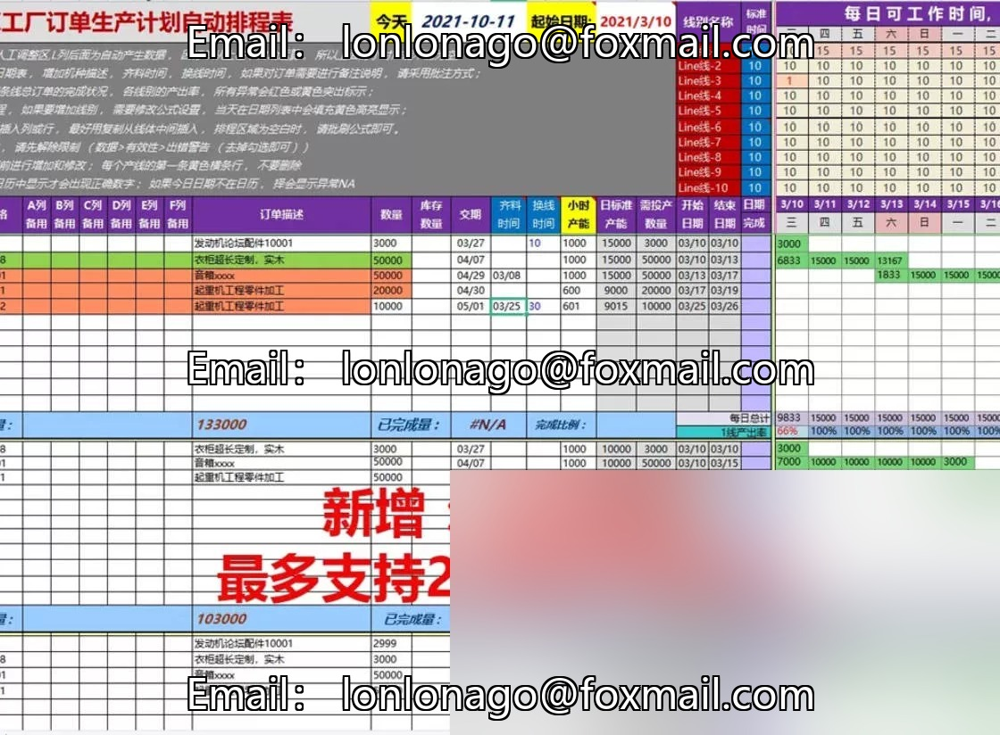
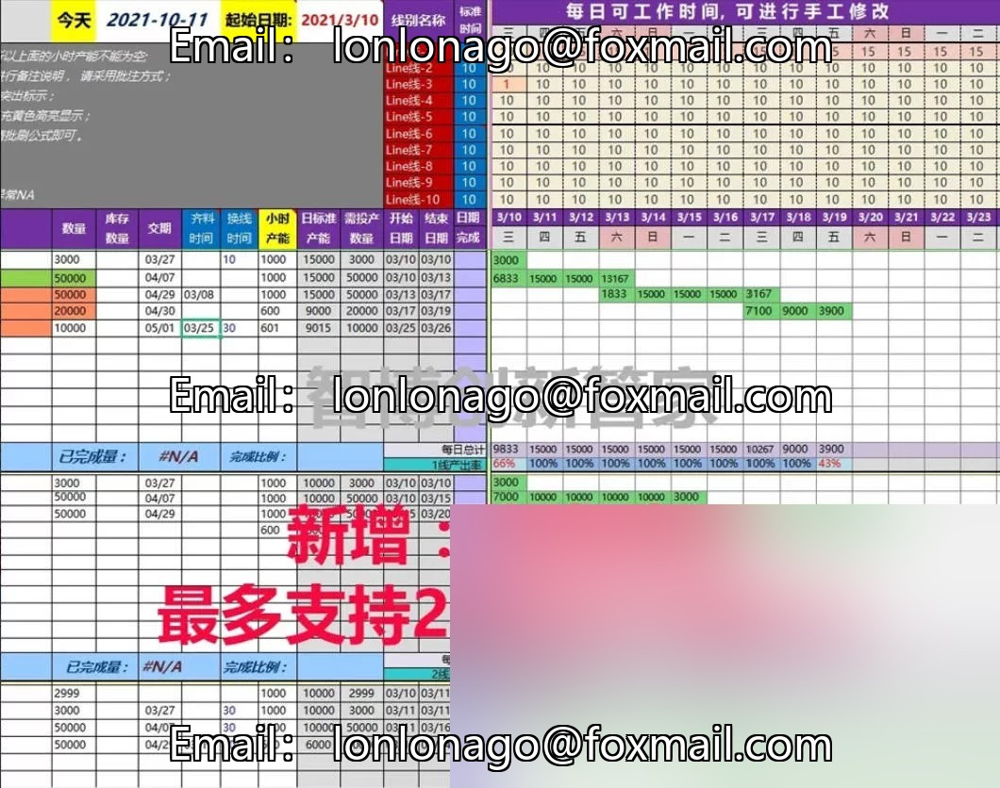

# PMC multi-step accessory furniture order management progress production plan automatic scheduling and production scheduling using Excel

## Body

PMC multi-process component furniture order management progress production plan automatic scheduling and production Excel table template

web-based shipment, can be directly photographed and shipped.

A multi-process component furniture order management and production plan auto-scheduling Excel template is provided, including factory order production plan auto-scheduling tables, daily working hours and various scheduling settings.

<!-- AI_ENRICHED -->

## Images

## Payment

Here is a pay link on Stripe ( https://buy.stripe.com/3cs8yP7sY87d0vu9AB ). Please contact me lonlonago@foxmail.com after funding $89, and I will send you a complete data files , thank you!

